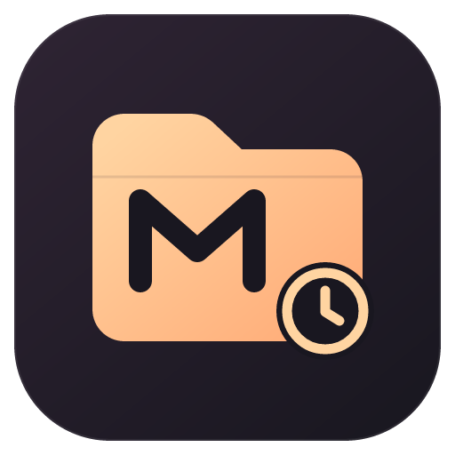

# Muse History Sidebar



Browse and manage the Muse conversation history on this machine, grouped by the original workspace folder, and resume main conversations in their original working directories.

This is an unofficial community extension, independently maintained and not affiliated with the engine vendor. It contains no conversation data, account credentials, or recovery backups.

## Features

- **Workspace-grouped history.** Every Muse session found on the machine is listed under its original workspace folder, with sub-agent records nested under their parent main session to any depth.
- **Static, refresh on demand.** History is read only when you press **Refresh**. Nothing runs in the background: no watcher, no timer, no resident engine process.
- **Rename.** Press F2 or use **Rename…** to give a session a display name. Names are stored by this extension (the Muse engine does not support renaming over its protocol on Windows) and are searchable together with the original title.
- **Archived view.** Archived sessions have their own **Archived** view below History; open, preview, rename or unarchive them directly.
- **Lightweight.** Each refresh or preview read starts the Muse engine and stops it as soon as the read is done. A new window shows the last refresh from a small saved snapshot without starting anything. Hidden preview tabs release their page.
- **Search and archive filter.** Search by title, display name or folder path; switch between unarchived, archived (required parents included), and all.
- **Read-only previews.** Paginated transcript preview for any session, including internal sub-agent records. Pages load on demand up to the end of the transcript. Previews never fetch remote images or links.
- **Session terminals.** Click a main conversation to open a Muse terminal in its original working directory. Clicking again switches back to the verified terminal instead of creating duplicates, including across window reloads.
- **Archive management.** Archiving is extension-owned view state, independent of Muse Desktop, and covers a session's whole family.
- **Recoverable removal.** Move a session directory to the Windows Recycle Bin through a native helper, with a confirmed scope and post-move verification on a fresh engine host.

## Requirements

- Windows x64.
- VS Code 1.144.0 or later.
- The Muse engine installed separately (validated with Muse Code 1.4.14). Terminal features require a local, trusted workspace.

## Getting started

1. Install the extension.
2. Click the **Muse History** icon in the activity bar.
3. The engine is discovered automatically from the local Muse installation and PATH. If discovery fails, click the gear in the sidebar view and select the native Muse executable (`muse-bin-<version>.exe`). The setting `museHistory.enginePath` is machine-scoped.

## Usage

- Expand a workspace folder and click a main conversation to open (or switch back to) its Muse terminal in the original working directory.
- Internal sub-agent records open a read-only preview; use **Muse: Open Parent Main Session Terminal** from the context menu to resume their parent. The current engine does not support resuming internal records directly.
- Right-click a session for **Preview**, **Rename…** (F2), **Restore Original Title**, **Archive**, **Remove Independent Archive**, or **Move to System Recycle Bin**.
- Archived sessions are listed in the **Archived** view; click one to open or switch to its terminal just like in History.
- The list is static: press **Refresh** in the toolbar to re-read history; the header shows when it was last refreshed. Nothing re-reads automatically (not on focus, not when the view is shown, not after a terminal closes). The toolbar also offers search, the archive filter, and engine selection.

## Archive vs. Recycle Bin

- **Rename** works the same way: the display name lives in this extension's state; Muse, Muse Desktop and `resume` keep the original title.
- **Archive** only changes what this extension shows. Files stay untouched on disk, and neither Muse Desktop nor a direct `resume` sees the flag. **Remove Independent Archive** clears a row's own flag; rows covered by an archived ancestor stay hidden until that ancestor is unarchived.
- **Move to System Recycle Bin** relocates the real session directory — including every child record inside it — into the Windows Recycle Bin. Recover by restoring the folder from the Recycle Bin, then refreshing the sidebar. This extension never permanently deletes data and never empties the Recycle Bin. A partially completed move is reported as such and never silently retried.

## Limitations

- Windows x64 only; remote VS Code windows cannot start local Muse sessions.
- Preview renders transcripts as stored text; images and links stay inert (never fetched).
- Opening a terminal requires the recorded original working directory to still exist; the extension refuses rather than starting in the wrong directory.
- If another Muse window holds the session, the Muse CLI shows its own occupancy prompt.

## Build and test from source

```powershell
npm ci
npm test
npm run package
```

`npm test` runs the synthetic unit tests. Real-engine and actual-recycle verification are opt-in via `MUSE_TEST_ENGINE` (and `MUSE_TEST_RECYCLE=1`); they use isolated synthetic HOME directories and never touch real user conversations. See the repository's bilingual README for the full verification guide.

The packaged VSIX uses this file as its store README (`vsce package --target win32-x64 --readme-path MARKETPLACE.md`).

## License

MIT. Based in part on applicable history-conversion and grouping logic from Etienne Lescot's open-source [Muse Desktop](https://github.com/EtienneLescot/muse-desktop), with attribution retained in `LICENSE`.
