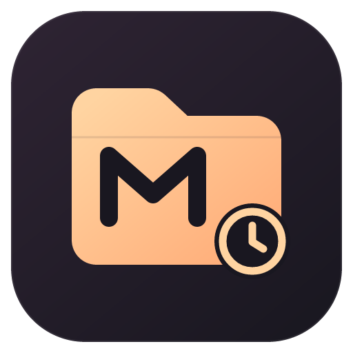

# Muse History Sidebar



Unofficial community VS Code extension for browsing and managing local Muse conversation history by workspace folder. This project is independently maintained and is not an official extension from the engine vendor.

- Workspace folders, parent/child conversations, title/path search and paginated read-only previews.
- Static list, refreshed only when you press Refresh; no background watcher, timer or resident engine process.
- Rename (F2) with an extension-owned display name, and a dedicated **Archived** view for direct access to archived sessions.
- Archive management and recoverable removal; each engine's different recovery behavior is explained below.
- Resume a main conversation in its original working directory and switch back to its verified terminal.
- Windows x64; VS Code 1.144.0 or later. Validated with Muse Code 1.4.14. The engine must be installed separately.
- Preview does not fetch remote transcript images or links. No conversation data, account credentials, or recovery backups are included in this repository.

0.2.0 adds rename, the Archived view and a static, refresh-on-demand list with no resident processes. Since 0.1.2 the extension UI and Marketplace listing are English; this README keeps full English and Chinese guides.

Install the Windows VSIX from [GitHub Releases](https://github.com/Great-us/muse-history-sidebar/releases). The publisher ID is `AlexWonton`.

MIT licensed; upstream attribution is retained in `LICENSE`.

## Usage

After installing the VSIX, click the **Muse History** icon on the left side of VS Code.

- Expand a folder and click a main conversation to open a Muse integrated terminal in its original working directory. Clicking again switches back to that terminal; clicking another main conversation opens or switches to another terminal.
- Internal sub-agent records open a read-only preview when clicked; the context menu offers **Open Parent Main Session Terminal** explicitly. The current Muse engine does not support resuming these internal records directly.
- Right-click a conversation to preview, rename (also F2), restore its original title, archive, remove its independent archive flag, or move it to the Windows Recycle Bin. Recycling a parent record includes the child records inside its on-disk directory; the UI confirms the scope first. Terminals still open for that scope must be closed first.
- **Rename** stores a display name in this extension. Muse 1.4.14 answers `session/rename` with "not supported on this platform" on Windows, so the name is not written into Muse: Muse Desktop and `resume` keep the original title. The sidebar, previews and new terminal titles show the display name, search matches both names, and the tooltip keeps the original Muse title. An empty name or **Restore Original Title** removes it.
- The **Archived** view below History lists every archived session (with its own search). Click a main conversation there to open or switch to its terminal, exactly as in History; right-click to preview, rename, unarchive or recycle.
- The toolbar provides refresh, title/folder search, an archive filter and engine selection. The list is **static**: history is re-read only when you press **Refresh** (or run an action that needs the engine, such as Move to Recycle Bin), and the header shows when it was last refreshed. Nothing re-reads automatically — not on focus, not when the sidebar is shown, not after a terminal closes. Previews load page by page and can be paged to the very end.
- **Resource use.** Between refreshes the extension runs nothing: no file watcher, no timer, no engine process. Each refresh or preview page starts the Muse engine host and stops it (and removes its temporary folder) as soon as the read finishes. The result of the last refresh is saved as a small JSON snapshot in the extension's storage, so a new VS Code window shows it without starting any process; only a first-ever start reads once. The engine is validated once per executable version. Previews load the Markdown renderer on first use, render only new entries on "Load more", and release their page when the tab is hidden.

Archiving is view state owned by this extension, independent of Muse Desktop. Moving to the Recycle Bin moves the real local session directory and can be undone from the Windows Recycle Bin; this extension never permanently deletes anything or empties the bin. After restoring, refresh the sidebar to rediscover the session.

When the original directory no longer exists, you get an explicit message instead of a session started in the wrong directory. If another Muse window is using the same session, the Muse CLI shows its occupancy prompt; "terminal opened" does not mean the CLI acquired the session. The extension never sends prompts into real conversations and never closes other terminals. Terminal resumption keeps Muse's own login, provider, sandbox and trust settings.

Since 0.1.1: while Muse is running it may temporarily withhold session directories. Only when this extension can confirm that a native terminal it opened itself is still alive does the sidebar reuse that terminal's verified historical launch directory, badged "Directory from launch record"; child records follow their parent main session's group. That directory is used only for display and for switching back to the original terminal — never for starting an unknown or stale session. Without a trusted launch record the directory is explicitly shown as unknown.

## Installation

In the VS Code Extensions menu choose **Install from VSIX…** and select the delivered `.vsix`. The official CLI also works:

```powershell
code --install-extension .\muse-history-sidebar-0.2.0-win32-x64.vsix
```

The engine is discovered automatically from the local Muse installation and PATH. When discovery fails, click the gear in the sidebar and select the native Muse `.exe`. The setting is `museHistory.enginePath`, machine-scoped. Remote VS Code windows do not start local Muse sessions; use terminal features in a local, trusted workspace.

## Recovery and deletion differences

- **Archive** only changes this extension's view state. The session directory and all conversation files stay on disk exactly where they were, and Muse Desktop or a direct `resume` never sees the flag. Use **Remove Independent Archive** to clear a row's own flag; a row covered by an archived ancestor stays archived until that ancestor is unarchived.
- **Move to System Recycle Bin** relocates the real session directory (including every child record inside it) into the Windows Recycle Bin through a native helper, then verifies on a fresh engine host that the session is no longer listed or readable. Recovery means restoring the folder from the Recycle Bin, then refreshing the sidebar. This extension never shreds or permanently deletes data and never empties the Recycle Bin.
- A partially completed move is reported as `partial`; the extension keeps its archive state and never silently retries the operation.

## Build from source

Requires Windows x64, Node.js 24+ and npm. The repository ships the prebuilt Windows recycle helper; a normal extension build needs no Rust.

```powershell
npm ci
npm test
npm run package
```

The default build output is `muse-history-sidebar-win32-x64-0.2.0.vsix`. Dependency versions are pinned by `package-lock.json`. `src/backend` uses Muse's official MSP interface and file metadata, `src/ui` provides the tree, preview and terminals, and `native-recycle` is the Windows recycle helper source. Packaging uses `MARKETPLACE.md` as the store README via `vsce package --readme-path MARKETPLACE.md`; this bilingual source README is excluded from the VSIX.

To rebuild the helper, install the Rust MSVC toolchain and Visual Studio C++ Build Tools, then run:

```powershell
.\scripts\build-native-recycle.ps1
```

## Verification

`npm test` runs the ordinary unit tests; real-engine and actual-recycle tests are explicitly opted in and skipped by default. Real-engine acceptance creates local echo sessions in a temporary synthetic HOME and never touches user conversations:

```powershell
$env:MUSE_TEST_ENGINE = 'C:\path\to\native-muse.exe'
npm test
npm run test:extension
```

`test:extension` uses an isolated VS Code configuration, extensions directory and synthetic Muse HOME to verify real integrated terminals, A→B→A switching, archive persistence and window reload. It never sends test messages into real user conversations. Use `MUSE_HISTORY_TEST_PHASES=reload` to run only the reload phase. The actual recycle test additionally requires `MUSE_TEST_RECYCLE=1`; it moves explicitly generated synthetic directories into the system Recycle Bin, recoverable like any other file.

This project builds on the applicable pure history-conversion and grouping logic from Etienne Lescot's open-source [Muse Desktop](https://github.com/EtienneLescot/muse-desktop), retaining the MIT license and attribution; see `LICENSE` for details.

## Migrating from the local build

The store version uses the `AlexWonton` publisher, a different extension ID from the earlier `local-muse-tools` local build. Local view archive flags and terminal re-adoption records do not migrate automatically; keep the old version installed until you have switched, and close its terminals before using the store version. The conversation files inside the engine stay where they were.

---

# Muse 历史记录 · VS Code 侧边栏

按原工作文件夹管理这台电脑上的 Muse Code 对话。非官方社区扩展 `AlexWonton.muse-history-sidebar`，独立维护，与引擎厂商无关；适用于 Windows x64、VS Code 1.144.0 及以上；已用 Muse Code 1.4.14 验证。0.1.2 起扩展界面与商店页面为英文；本 README 保留完整中英文指南。原 Muse Desktop 可继续使用。

- 工作文件夹分组、父子对话、标题/路径搜索与分页只读预览。
- 静态列表：只在点“刷新”时读取；后台没有监听、定时器或常驻引擎进程。
- 重命名（F2，本扩展保存的显示名称），以及独立的 **Archived**（已归档）视图，可直接访问已归档会话。
- 归档管理与可恢复移除；各引擎恢复行为的差异见下文。
- 在原工作目录恢复主对话，并切回其已验证的终端。
- 预览不抓取远端对话图片或链接。本仓库不含对话数据、账号凭据或恢复备份。

## 使用

安装 VSIX 后，点击 VS Code 左侧的 **Muse History**（Muse 历史记录）图标。

- 展开文件夹，点击主对话，在其原工作目录打开 Muse 集成终端。再次点击会切回该终端；点击其他主对话会打开或切到另一终端。
- 内部子智能体记录点击后只读预览；右键可明确选择 **Open Parent Main Session Terminal**（打开父主会话终端）。当前 Muse 引擎不支持直接恢复这些内部记录。
- 右键对话可预览、重命名（Rename…，也可按 F2）、恢复原标题（Restore Original Title）、归档、移除独立归档标记（Remove Independent Archive），或移到 Windows 回收站（Move to System Recycle Bin）。回收一个父记录会包含其磁盘目录内的子记录；界面会先确认范围。打开中的对应终端需先关闭。
- **重命名**保存的是本扩展的显示名称。Muse 1.4.14 在 Windows 上对 `session/rename` 返回“not supported on this platform”，因此名称不会写进 Muse：Muse Desktop 和 `resume` 仍显示原标题。侧栏、预览和新开终端的标题使用显示名称，搜索同时匹配两个名称，悬停提示保留 Muse 原标题。名称留空或选“恢复原标题”即可清除。
- History 下方的 **Archived**（已归档）视图列出全部已归档会话（有独立搜索）。在其中点击主对话即可打开或切回其终端，与 History 中一致；右键可预览、重命名、取消归档或移到回收站。
- 顶部按钮提供刷新、标题/文件夹搜索、归档筛选和引擎选择。列表是**静态**的：只有点“刷新”（或执行需要引擎的操作，如移到回收站）时才重新读取，标题栏显示上次刷新时间。不会自动重读——切回窗口、显示侧栏、关闭终端都不会触发。预览按页加载，可一直加载至末尾。
- **资源占用**：两次刷新之间扩展什么都不运行：没有文件监听、没有定时器、没有引擎进程。每次刷新或预览翻页都会启动 Muse 引擎，读完立即停止并删除其临时文件夹。上次刷新的结果以小型 JSON 快照保存在扩展存储中，新开 VS Code 窗口直接显示快照，不启动任何进程；只有首次使用（还没有快照）时会读取一次。引擎每个可执行版本只校验一次；预览首次打开才加载 Markdown 渲染器，“加载更多”只渲染新内容，预览标签页隐藏时释放页面。

归档是本扩展自己的视图状态，独立于 Muse Desktop。移到回收站会通过原生助手移动真实的本机会话目录，可通过 Windows 回收站恢复；本扩展不会永久删除或清空回收站。恢复后刷新侧边栏即可重新发现。

原目录已不存在时，会明确提示，避免在错误目录启动会话。若同一会话正在其他 Muse 窗口使用，由 Muse CLI 显示占用提示；“终端已打开”不代表 CLI 已成功获得该会话。扩展不向真实对话自动发送提示词，不关闭其他终端。终端恢复沿用 Muse 原有的登录、提供方、沙箱和信任设置。

0.1.1 起：Muse 运行中可能暂时不提供会话目录。仅当本扩展能确认自己打开的原生终端仍存活时，侧栏才沿用该终端已验证的历史启动目录，并标注 “Directory from launch record”（目录来自启动记录）；子记录随父主会话分组。该目录只用于显示及切回原终端，不用于另开未知或过期会话。无可信启动记录时明确显示目录未知。

## 安装

在 VS Code 扩展菜单选择 **Install from VSIX… / 从 VSIX 安装…**，选中交付的 `.vsix`。也可使用官方 CLI：

```powershell
code --install-extension .\muse-history-sidebar-0.2.0-win32-x64.vsix
```

引擎默认从本机 Muse 安装和 PATH 中发现。找不到时，点击侧边栏齿轮，选择 Muse 原生 `.exe`。设置项为 `museHistory.enginePath`，仅作用于本机。远程 VS Code 窗口不启动本机 Muse 会话；在本机受信任工作区使用终端功能。

## 恢复与删除的差异

- **归档**只改变本扩展的视图状态。会话目录和全部对话文件原样留在磁盘，Muse Desktop 或直接 `resume` 都看不到该标记。**Remove Independent Archive**（移除独立归档）只清除该行自己的标记；被已归档祖先覆盖的行要等祖先取消归档后才恢复显示。
- **移到系统回收站**把真实会话目录（含其中全部子记录）经原生助手移入 Windows 回收站，随后在全新引擎宿主上核验该会话不再列出、不可读取。恢复方式是从回收站还原文件夹，再刷新侧边栏。本扩展绝不粉碎、永久删除数据，也不清空回收站。
- 移动部分完成会以 `partial` 如实报告；扩展保留归档状态，不会悄悄自动重试。

## 从源码构建

需要 Windows x64、Node.js 24+ 和 npm。源码附带 Windows 回收助手的已构建文件；普通扩展构建不需要 Rust。

```powershell
npm ci
npm test
npm run package
```

默认构建产物为 `muse-history-sidebar-win32-x64-0.2.0.vsix`。依赖版本由 `package-lock.json` 锁定。`src/backend` 使用 Muse 官方 MSP 接口和文件元数据，`src/ui` 提供树、预览和终端，`native-recycle` 是 Windows 回收助手源码。打包通过 `vsce package --readme-path MARKETPLACE.md` 以 `MARKETPLACE.md` 作为商店 README；本双语言源码 README 不会进入 VSIX。

如需重新构建助手，先安装 Rust MSVC 工具链和 Visual Studio C++ Build Tools，再运行：

```powershell
.\scripts\build-native-recycle.ps1
```

## 验证

`npm test` 包含普通单元测试；真实引擎和实际回收测试显式启用，默认跳过。真实引擎验收在临时合成 HOME 中创建本地 echo 会话，不修改用户对话：

```powershell
$env:MUSE_TEST_ENGINE = 'C:\path\to\native-muse.exe'
npm test
npm run test:extension
```

`test:extension` 使用本机 VS Code 的隔离配置、扩展目录和合成 Muse HOME，验证真实集成终端、A→B→A 切换、归档持久化及窗口重载。它不会向用户真实对话发送测试消息。可用 `MUSE_HISTORY_TEST_PHASES=reload` 仅运行重载阶段。实际回收测试另需 `MUSE_TEST_RECYCLE=1`，会将明确生成的合成目录送入系统回收站；恢复方式与普通文件相同。

本项目基于 Etienne Lescot 的开源 [Muse Desktop](https://github.com/EtienneLescot/muse-desktop) 中适用的纯历史转换与分组逻辑加工，保留 MIT 授权及署名；具体许可见 `LICENSE`。

## 从本地构建切换

商店版本使用 `AlexWonton` 发布者，与此前 `local-muse-tools` 本地构建是不同扩展 ID。本地视图归档标记和终端认回记录不会自动迁移；切换前请保留旧版，并关闭其对应终端后再使用商店版。引擎中的对话文件仍在原处。
